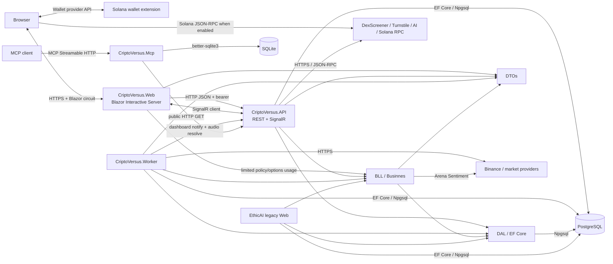
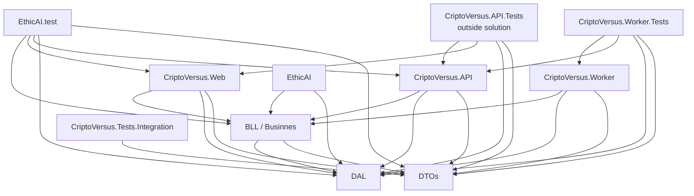
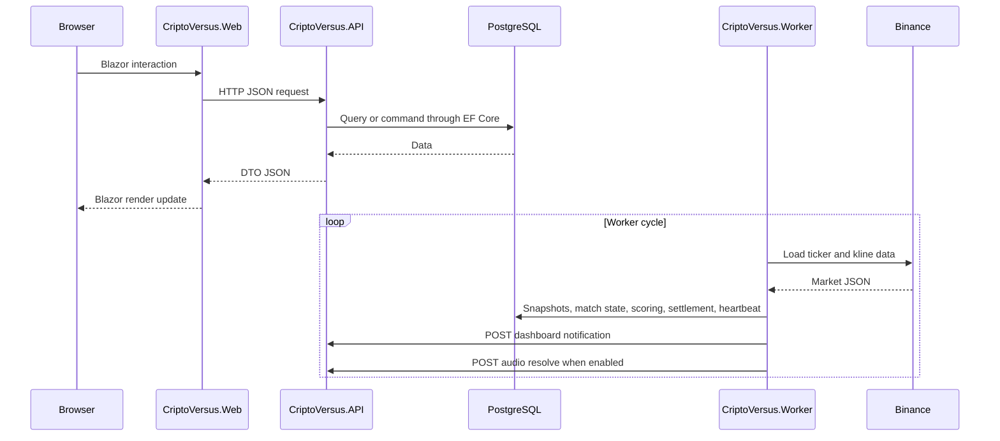
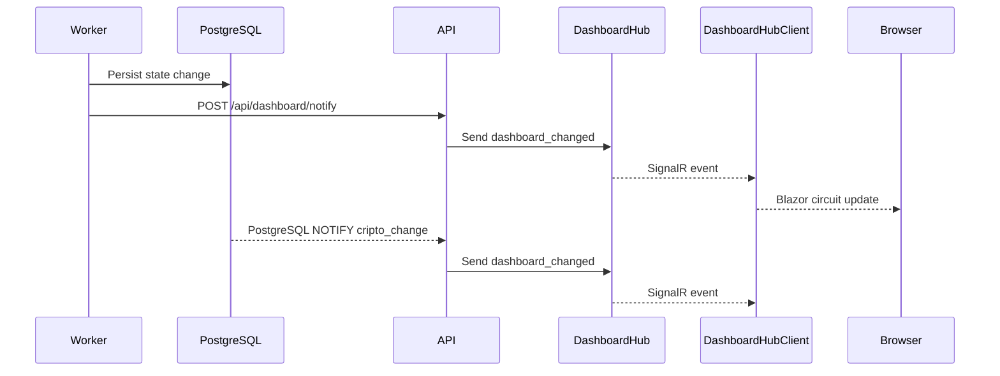
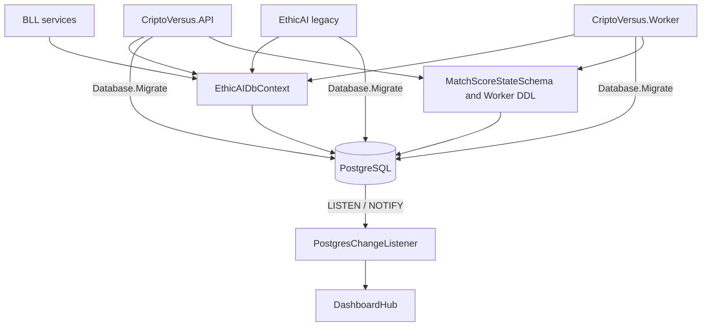
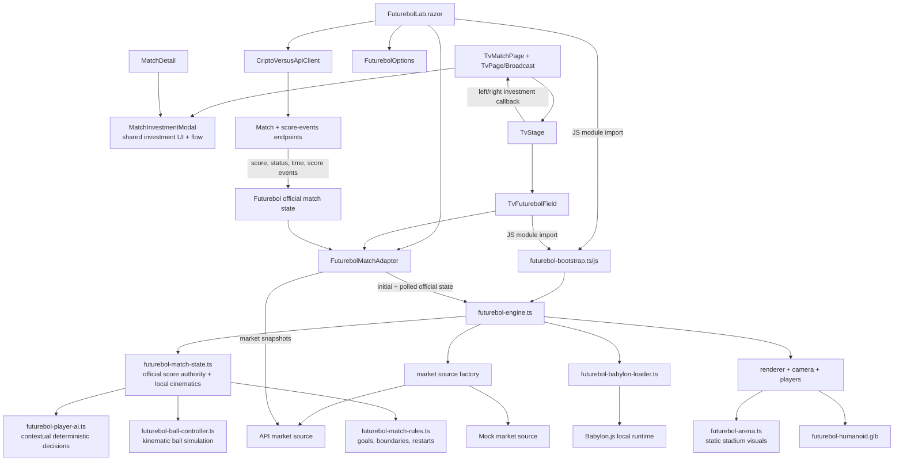
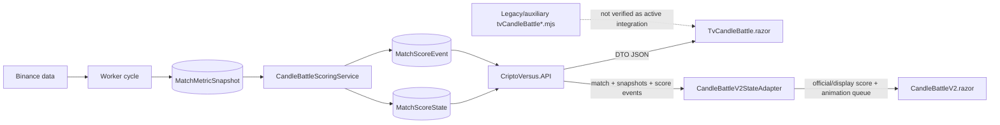
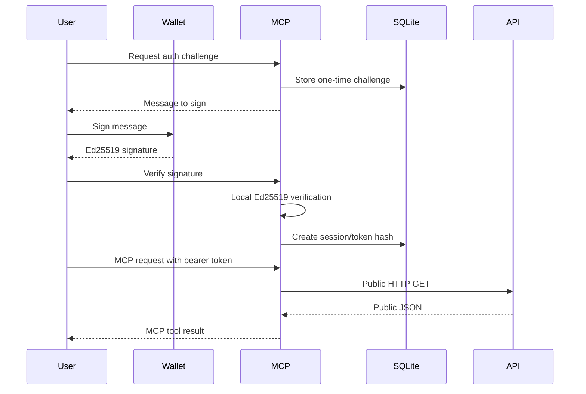

# CriptoVersus Architecture

## Purpose

This document is the architecture reference for the CriptoVersus repository. It is intended for maintainers, new contributors, code-review tools, and AI coding agents.

The document describes the architecture observed in the source code. It does not expose or depend on production secrets. When this document conflicts with executable code, project manifests and source code are the source of truth, and this document should be updated in the same change.

## Scope

The active and related projects are:

- `CriptoVersus`: current Blazor Web frontend (`CriptoVersus.Web`).
- `CriptoVersus.API`: ASP.NET Core API and SignalR server.
- `CriptoVersus.Worker`: market, scoring, settlement, and retention worker.
- `CriptoVersus.Mcp`: read-only Node.js/TypeScript MCP server.
- `Businnes`: business layer, compiled as `BLL`.
- `DAL`: EF Core entities, mappings, migrations, and PostgreSQL context.
- `DTOs`: shared transport and presentation contracts.
- `CriptoVersus.API.Tests`: API-focused tests; currently outside `EthicAI.sln`.
- `CriptoVersus.Worker.Tests`: worker, scoring, and retention tests.
- `CriptoVersus.Tests.Integration`: opt-in black-box financial tests against a running API.
- `EthicAI.test`: mixed tests for current Web, API, BLL, and DAL behavior.
- `EthicAI`: legacy Blazor application that still builds as part of the solution.
- `docs`: operational SQL documentation.
- `solana`: ancillary Anchor/Rust program and scripts, outside the .NET solution.

## High-Level Architecture



Important qualifications:

- The browser normally talks to the API through the Blazor Server process, not as a browser-side SPA.
- The active SignalR client is `DashboardHubClient` in the Web server process. SignalR events reach the browser through the Blazor circuit.
- API and Worker both access PostgreSQL directly. Their main integration contract is the shared schema, not only HTTP.
- The Web project has a direct build reference to DAL, but no direct DAL usage was found in current Web source.
- MCP is a solution folder, not an MSBuild project. It has an independent npm build.

## Solution and Build Dependencies

The root solution is `EthicAI.sln`.



### Manifest Evidence

| Origin | Direct project references | Manifest |
|---|---|---|
| BLL | DAL, DTOs | `Businnes/BLL.csproj` |
| CriptoVersus.Web | BLL, DAL, DTOs | `CriptoVersus/CriptoVersus.Web.csproj` |
| CriptoVersus.API | BLL, DAL, DTOs | `CriptoVersus.API/CriptoVersus.API.csproj` |
| CriptoVersus.Worker | BLL, DAL, DTOs | `CriptoVersus.Worker/CriptoVersus.Worker.csproj` |
| EthicAI | BLL, DAL | `EthicAI/EthicAI.csproj` |
| EthicAI.test | BLL, Web, API, DAL, DTOs | `EthicAI.test/EthicAI.test.csproj` |
| Worker.Tests | Worker, API, DAL, DTOs | `CriptoVersus.Worker.Tests/CriptoVersus.Worker.Tests.csproj` |
| Integration Tests | DTOs | `CriptoVersus.Tests.Integration/CriptoVersus.Tests.Integration.csproj` |
| API.Tests | API, Web, DAL, DTOs | `CriptoVersus.API.Tests/CriptoVersus.API.Tests.csproj` |
| MCP | npm dependencies only | `CriptoVersus.Mcp/package.json` |

`DAL` has no project reference to `DTOs`. This direction is intentionally absent.

## Project Responsibilities

### CriptoVersus.Web

Primary files:

- `CriptoVersus/Program.cs`
- `CriptoVersus/Components`
- `CriptoVersus/Services/CriptoVersusApiClient.cs`
- `CriptoVersus/Services/DashboardHubClient.cs`
- `CriptoVersus/wwwroot/js`

Responsibilities:

- Public match, statistics, ranking, token, roadmap, FAQ, and risk pages.
- TV and broadcast presentation.
- Wallet, position, dashboard, and administration pages.
- Localized routes and content for the cultures registered in `CriptoVersus/Services/SupportedLanguageCatalog.cs` (en-US, pt-BR, zh-CN, es-ES, fr-FR, de-DE, it-IT, ja-JP).
- SEO, canonical URLs, sitemaps, redirects, and social images.
- Futurebol experimental 3D frontend.
- HTTP client facade for the API.
- Server-side SignalR client for dashboard invalidation events.

The application is an Interactive Server Blazor application. Component C# runs on the Web server. Browser-side JavaScript is used for wallet providers, media, charts, audio, TV effects, and Futurebol.

Culture resolution is owned by `CriptoVersus/Services/AppCultureService.cs` and uses this priority:

1. Explicit culture segment in the request path.
2. Persisted user preference (`cv_culture` cookie, mirrored from `localStorage` by `wwwroot/js/culturePreference.mjs`).
3. Browser language (`Accept-Language` on the server, `navigator.languages` in the browser module).
4. Approximate region from the infrastructure-provided `CF-IPCountry` header (Cloudflare). No GPS and no external geolocation API are used.
5. `en-US`.

`Program.cs` pins `CultureInfo.DefaultThreadCurrentCulture`/`DefaultThreadCurrentUICulture` to `en-US` so interactive Blazor rendering can never inherit the host OS culture. Components must resolve culture from the route or `AppCultureService`, never from `CultureInfo.CurrentUICulture`. Culture-selection redirects are temporary (302) because they depend on the visitor; canonical slug corrections stay permanent (301).

### CriptoVersus.API

Primary files:

- `CriptoVersus.API/Program.cs`
- `CriptoVersus.API/Controllers`
- `CriptoVersus.API/Hubs/DashboardHub.cs`
- `CriptoVersus.API/Service`

Responsibilities:

- Wallet-signature login and JWT issuance.
- Matches, bets, positions, wallet actions, settlement views, and administration.
- Dashboard, Worker status, statistics, tokenomics, TV, social, and audio APIs.
- Community match creation and captcha validation.
- SignalR dashboard hub.
- PostgreSQL access and startup migrations.
- External integrations such as DexScreener, Turnstile, AI narration, Solana verification/transfers, and image sources.

The fallback authorization policy requires authentication unless an endpoint explicitly allows anonymous access.

### CriptoVersus.Worker

Primary files:

- `CriptoVersus.Worker/Program.cs`
- `CriptoVersus.Worker/Worker.cs`
- `CriptoVersus.Worker/DataRetentionService.cs`
- `CriptoVersus.Worker/DataRetentionWorker.cs`

Responsibilities:

- Load market snapshots.
- Maintain current currency and price data.
- Normalize, create, start, cancel, and complete matches.
- Persist metric snapshots.
- Execute scoring rules, Candle Battle, and Arena Pressure.
- Persist score events with deduplication.
- Settle bets and persistent positions.
- Maintain pending and ongoing match pools.
- Update Worker heartbeat and health state.
- Notify the API after state changes.
- Request procedural audio resolution from the API.
- Aggregate and delete old metric data.

The Worker is not called by the API to perform a cycle. It runs independently as a hosted service.

### BLL / Businnes

Primary areas:

- `GameRules`: match lifecycle decisions.
- `NFTFutebol`: match service, scoring engine, and Candle Battle.
- `ArenaSentiment`: public market pressure and Arena Pressure scoring.
- `Blockchain`: off-chain, hybrid, and full-on-chain fund abstractions.
- `Positions`: persistent position orchestration.
- Legacy services for users, posts, pre-sale, GitHub, Binance, and Solana.

The physical directory name `Businnes` is misspelled. The logical project and assembly are named `BLL`.

### DAL

Primary files:

- `DAL/EthicAIDbContext.cs`
- `DAL/EthicAIDbContextFactory.cs`
- `DAL/MigrationConnectionResolver.cs`
- `DAL/NftFutebol`
- `DAL/Migrations`

Responsibilities:

- EF Core context and entity mappings.
- PostgreSQL migrations.
- Design-time connection resolution and update guard for `dotnet ef` (see `docs/ef-migrations.md`).
- Match, team, currency, bet, scoring, snapshot, ledger, position, social, audio, narration, and Worker status entities.
- Legacy user, post, category, and pre-sale entities.
- Runtime schema helpers for scoring state.

DAL currently exposes the EF context and entities directly to API, Worker, BLL, and legacy EthicAI code. It is not a repository abstraction.

### DTOs

Responsibilities:

- Shared request, response, presentation, and event contracts.
- Match, scoring, wallet, position, dashboard, Worker, statistics, social, token, TV, community match, and audio models.
- Shared text and procedural audio utilities.

DTOs should remain infrastructure-independent.

### CriptoVersus.Mcp

Primary files:

- `CriptoVersus.Mcp/src/index.ts`
- `CriptoVersus.Mcp/src/http/criptoversusClient.ts`
- `CriptoVersus.Mcp/src/auth`
- `CriptoVersus.Mcp/src/db`
- `CriptoVersus.Mcp/src/tools`

Responsibilities:

- Expose read-only public CriptoVersus tools through MCP Streamable HTTP.
- Authenticate users through locally verified Solana wallet signatures.
- Create and revoke MCP tokens.
- Store challenges, sessions, and token hashes in SQLite.
- Consume public API endpoints through HTTP GET.

Only `get_hot_matches` currently maps to a verified API endpoint. The routes used by `get_live_matches`, `get_match_stats`, and `get_rankings` are not implemented in the current API revision.

### Test Projects

- `EthicAI.test`: mixed unit tests for BLL, API, Web services, SEO, routes, TV, wallet, and Arena Sentiment.
- `CriptoVersus.API.Tests`: API and Web utility tests; not included in `EthicAI.sln`.
- `CriptoVersus.Worker.Tests`: Worker, scoring, Candle Battle, endpoint, and retention tests.
- `CriptoVersus.Tests.Integration`: opt-in black-box financial tests against a running API.
- Frontend npm tests: Futurebol and TV/audio/chart modules.

### EthicAI Legacy Application

`EthicAI/EthicAI.csproj` is a legacy Blazor Server application. It directly uses BLL, DAL, PostgreSQL, and historical blog/pre-sale functionality. It remains in `EthicAI.sln` and applies migrations at startup, but it is not the current CriptoVersus frontend.

## Web, API, and Worker Flow

There is no synchronous `API -> Worker` command path. The actual flow is a combination of HTTP and a shared database.



The API reads Worker state from PostgreSQL. It does not query the Worker process directly.

## SignalR Flow



Notes:

- `DashboardHubClient` runs in the Web server process.
- The active event contract is the string `dashboard_changed`.
- A legacy JavaScript hub client exists but is not the active path.
- Multi-instance API deployment would require a SignalR backplane or managed SignalR service.

## PostgreSQL Flow



The shared schema is a strong runtime contract. API and Worker must be deployed with compatible entity and migration versions.

EF Core design-time tooling (`dotnet ef`) does not use runtime configuration. `DAL/EthicAIDbContextFactory.cs` resolves the connection through `DAL/MigrationConnectionResolver.cs` with priority `CRIPTOVERSUS_MIGRATION_CONNECTION`, `ConnectionStrings__Default`, then `ConnectionStrings:Default` in appsettings files, and fails clearly when none is set. There is no hardcoded credential fallback. Read-only commands (`migrations list`, `migrations script`) run against any target; `database update` against a non-local target requires `CRIPTOVERSUS_MIGRATION_ALLOW_UPDATE=true`. Operational procedure: `docs/ef-migrations.md`.

## Futurebol Flow

Futurebol is the official 3D field renderer for fixed Match TV and rotating Broadcast. The `/lab/futurebol` route remains its diagnostic laboratory.



Source locations:

- Blazor host: `CriptoVersus/Components/Pages/Futurebol`.
- Official TV host: `CriptoVersus/Components/Pages/Internet/TvFuturebolField.razor` through `TvStage`.
- Shared Partida/TV investment overlay: `CriptoVersus/Components/Pages/Internet/MatchInvestmentModal.razor`.
- Shared DTO-to-presentation boundary: `CriptoVersus/Services/FuturebolMatchAdapter.cs`.
- TypeScript source: `CriptoVersus/wwwroot/js/futurebol`.
- Compiled output: `CriptoVersus/wwwroot/js/dist/futurebol`.
- Babylon vendor files: `CriptoVersus/wwwroot/js/futurebol/vendor`.
- Player model: `CriptoVersus/wwwroot/assets/futurebol/players/futurebol-humanoid.glb`.

The TypeScript source is authoritative. Files under `wwwroot/js/dist` are generated output. Futurebol supports deterministic mock data and API-fed match snapshots.

`FuturebolArena` owns only the static stadium presentation used by Lab, Match, and Broadcast: open stepped stands, thin-instanced individual seat backs and stylized spectators, concourses, framed tunnels, advertising boards, shell ribs, roof trusses, decorative scoreboards, and thin-instanced emissive floodlight bulbs. Repeated structural boxes are merged by shared material, thin instances keep the repeated seating/crowd/light geometry inexpensive, static transforms and materials are frozen, and secondary detail groups are disabled in Low quality. Because these browser modules are emitted as nested native ESM files rather than a fingerprinted bundle, the bootstrap, engine, renderer, and arena import chain carries the same release query token so an updated arena cannot be hidden by a stale transitive module cache. The arena adds no dynamic lights, physics bodies, gameplay state, textures, or camera behavior.

`FuturebolLedAdvertising` is a separate dynamic presentation module owned by the renderer. Its fixed emissive boards mount on the near canopy: the existing canopy occludes ground-level advertising from the broadcast camera. It consumes the renderer's home/away market assets and borrows the player logo canvases without owning or fetching them. Existing engine snapshot callbacks also populate a per-instance cache of at most 16 symbols, expiring five minutes after receipt, so rotating Broadcast can advertise previously observed coins. There is no new market/news request and no invented-price fallback. Textures upload only on staggered five-second rotations; fades change texture intensity. Quality controls board count and resolution, and renderer disposal releases board meshes/materials/textures and the cache. Short phrases use the document language (pt/en/zh); optional headlines remain an input seam, not a news integration. See `docs/futurebol-led-advertising.md` for geometry and validation limits.

`FuturebolMatchState` remains the gameplay coordinator and official/local score boundary. Player movement uses base positions, role zones, tactical intents, arrival steering, and separation inside that state. Contextual possession decisions and pass-target scoring are isolated in `FuturebolPlayerAI`; ball acceleration, rolling drag, bounce, and player/goal-frame collisions are isolated in `FuturebolBallController`; field-boundary, goal, and restart classification are isolated in `FuturebolMatchRules`. These modules are deterministic and do not own or modify player visuals. The Babylon renderer continues to consume positions and animation state without becoming authoritative for match rules.

In API mode, `MatchDto`, `TvHotMatchDto`, snapshots, and `MatchScoreEventDto` events are mapped by `FuturebolMatchAdapter` into a dedicated browser presentation contract. Both the Lab and TV host use that adapter. Official score and clock are authoritative. Local plays remain cinematic, cannot increment the official score, and are forced to visual saves unless a new deduplicated official score event requests a goal cinematic. Initial/reloaded events establish a baseline and are not replayed.

Team logo identity still comes from the match/API icon URL. `FuturebolTeamLogoUrl` maps the official icon route to the Web same-origin `/futurebol/team-logo/{symbol}` transport, which proxies the API image bytes so Babylon can safely upload them to a WebGL texture even when the API and Web origins differ. This transport does not maintain a symbol-to-logo table or become a second logo authority.

The TV host updates an existing `FuturebolEngine` for the same match and calls its match reconfiguration path during Broadcast rotation. A canvas retains one Babylon engine, scene, render loop, and loaded humanoid asset for its lifetime; match changes reset official/simulation state and replace team symbols/logo textures without rebuilding the scene. Container resize uses `ResizeObserver`. The existing TV polling remains the transport; Futurebol does not add a scoring or persistence path and does not subscribe to a dedicated SignalR event.

Investment from TV is an overlay interaction, not a route transition. `TvStage` emits a left/right callback to `TvMatchPage` or `TvPage`; those page hosts open the same `MatchInvestmentModal` used by `MatchDetail`. The modal owns the existing wallet-balance guard, on-chain preparation, authenticated bet request, and amount validation. It is rendered as a sibling of `TvStage`, so opening or closing it does not dispose the Futurebol canvas, Babylon engine, replay state, or audio. The `/partida/...#match-investment` fragment remains a separate external deep-link path handled by `MatchDetail`.

## Candle Battle Flow

Candle Battle has two related but separate implementations: authoritative scoring in BLL/Worker and presentation in Web.



Authoritative score path:

1. Worker persists paired metric snapshots.
2. `BLL.NFTFutebol.CandleBattleScoringService` evaluates candle dominance.
3. The service updates score state and produces deduplicated score events.
4. API exposes match, snapshot, and score event DTOs.

Presentation path:

1. Web receives price points and match data.
2. `Services/CandleBattleChartModelBuilder` pairs both assets by the exact snapshot timestamp, derives observed OHLC intervals from consecutive persisted prices, and normalizes every OHLC value against the first paired price for its asset.
3. The builder calculates one shared Y domain from the minimum normalized low and maximum normalized high across both assets.
4. `Components/Shared/TvCandleBattle.razor` renders both candle series in one responsive SVG, using a small horizontal offset inside each shared time slot and an integrated per-candle winner band.
5. The component continues to own presentation-only score, momentum, streak, and tactical UI. Authoritative score remains in BLL/Worker.

`MatchDetail` and `TvStageTelemetryStack` use the same `RenderBattleChart()`, model, shared domain, geometry builder, and internal CSS. The logical SVG height is fixed; CSS scales the viewport without a JavaScript resize callback or geometry cache. TV layout rules must size only the outer container: `tv-candle-battle__body` is an SVG candle rectangle, not a layout wrapper, and assigning CSS height to it overrides its financial open/close geometry. Tactical-panel visibility affects only the surrounding layout.

`MatchMetricSnapshot` currently persists only `LastPrice`, not exchange OHLC. The presentation therefore uses the actual consecutive observed prices as open/close and their observed extrema as high/low; it does not fabricate wick values. Adding exchange-interval OHLC later requires an explicit DTO/schema/Worker contract expansion and does not belong to the authoritative scoring rule by default.

The isolated V2 route `/{culture}/candle/{matchId}/{slug}` hosts `CandleBattleV2`. It bootstraps block piles directly from the official `MatchDto` score, records the existing `MatchScoreEventId` values without replaying them, and then orders new persisted `CANDLE_BATTLE_DOMINANCE` events by `EventSequence` in `CandleBattleV2StateAdapter`. Other rule events are never presented as candle battles; any authoritative score difference is reconciled without inventing an animation. SignalR `dashboard_changed` is only an invalidation signal; V2 refetches match, event, and snapshot DTOs, while periodic polling covers missed notifications. Returning from a background tab performs an immediate non-animated reconciliation. DOM/CSS phases render the candle collision and square-block drop, but cannot create or persist score.

V2 obtains prices and forming-candle input from `MatchMetricSnapshotDto`, logos from `CoinSocialProfile` (with the existing Binance icon transport as fallback), and registered colors from the same profile. A deterministic symbol-derived color is used only when no profile color exists. The original `TvCandleBattle` remains unchanged and active in TV presentation.

The Web visualization must not be treated as the authoritative scoring engine. The `tvCandleBattleEngine.mjs`, `tvCandleBattleHud.mjs`, and `tvCandleBattleMarkers.mjs` modules exist, but no active import path was verified for the current Razor implementation.


### Candle Battles arcade (independent 5M competition)

The additive arcade route is /{culture}/tv/candle/{matchId}/{slug}, with an API-free demo at /{culture}/games/candle-battles/demo. Existing TV and V2 routes remain available. CandleBattlesHost uses the existing DashboardHubClient invalidation and server-side CriptoVersusApiClient, then sends a dedicated DTO feed to the local Phaser 3.90.0 engine. There is no browser market connection or new Web-to-DAL access.

The Worker appends the candle-battles-arcade stage after its existing stages. CandleBattlesRoundService uses an isolated scope, touches heartbeat between matches, and obtains actual exchange OHLCV through BinanceKlineClient. That client also owns the existing volume-window kline transport. Both closed 5M intervals and twenty contiguous prior candles are validated against exchange server time. CandleBattlesResolver compares `((Close - Open) / Open) * 100` for the official arcade winner; the separately versioned 45/25/20/10 strength formula remains the explicit tie-breaker. The resolver never writes the financial match score, dominance state, ledger or settlement records.

Migration 20261015000000_AddCandleBattlesArcade adds candle_battles_round and candle_battles_state. Worker is the sole writer. A (MatchId, OpenTimeUtc) primary key plus per-match transaction advisory lock makes round insertion and durable cursor advancement atomic. API and Worker retain their existing migration-startup ownership. GET /api/matches/{matchId}/candle-battles exposes paginated immutable rounds, forming OHLCV, provisional strength, arcade score and failure/staleness status; for rounds written with a pre-return rule version, the API normalizes the projected winner from stored OHLC without mutating the immutable row. Replay and reconnection reconstruct points and territory only from these rounds.

The arcade match window uses the exchange five-minute interval containing Match.StartTime and at most eighteen consecutive closed intervals. The Worker caps processing at that eighteenth close and at an earlier Match.EndTime, requires paired confirmed candles, and marks the arcade state complete after the Match is terminal and its eligible intervals have been processed. If confirmed market data is still missing fifteen minutes after the final eligible close, the Worker marks the arcade feed incomplete and stops revisiting that match; it does not invent a round. The feed includes Match start/end timestamps, server response time and the expected round count. The Phaser replay advances a virtual clock from Match.StartTime; LIVE aligns its browser clock to the API response time and only animates persisted confirmed rounds. Both display the same match and candle timers, while scores and territory come only from confirmed stored rounds. A completed feed with fewer than eighteen rounds shows an incomplete result instead of declaring a winner. The arcade score remains separate from the official Match.ScoreA/ScoreB and settlement winner.

The TypeScript renderer draws financial body/wicks and keeps the OHLC geometry separate from real, alpha-trimmed fighter action sprites. The atlas registers team and OHLC-direction variants for RUN, PUNCH, BREAK and RECOVER; uniform sprite scaling preserves artwork proportions while candle body size remains financial. A snapshot for an active battle is immutable while the independent heartbeat receives the next candle. Audio, resize and browser listeners are instance-owned and disposed. The build emits versioned local Phaser and native ESM modules; generated JS is not hand-edited. User-supplied source art stays outside wwwroot, and visual-test fixtures are excluded from publication. See docs/candle-battles.md for formula parameters, schema ownership, asset preparation and verification limits.

The arcade host now renders the market cards, one five-minute countdown, match clock, score, recent confirmed rounds, territory grid, and final result as localized HTML around the Phaser canvas. `game.ts` projects its existing LIVE server-time anchor or Replay virtual clock into that DOM; the five-minute countdown follows the server or virtual market clock and resets at each exchange interval even when round confirmation is delayed; it never generates a score itself. Phaser remains responsible for the stadium, OHLC geometry, sprite combat, audio, and comic dialogue. The DOM territory grid is reconstructed from the same immutable rounds and score used by the engine.


`candle-battles/dialogue.ts` owns the local, eight-language comic dialogue catalog and deterministic selection by match, round and idle slot. `game.ts` advances one two-line conversation on the existing presentation clock, including Replay speed and pause, and interrupts it at combat. The HTML bubble tracks the Phaser sprite anchor through the fitted canvas and stays separate from scoring, market data, and the persisted round timeline. Final winner, loser and draw lines use the same presentation layer.

## Candle Battle Social Flow

`CandleBattleSocialController` exposes `/api/social/candle-battle/highlight`,
`/highlights/candidates`, `/{matchId}`, and the `reserve`/`confirm`/`release`
publication actions. Public GETs are side-effect free; candidate diagnostics and
mutations use the existing `SocialAutomation` policy. The service reads only
persisted `candle_battles_round` and `candle_battles_state` records and uses
`CandleBattlesRoundProjection`, shared with `CandleBattlesController`, to normalize
legacy winners. Its arcade score is separate from `Match.ScoreA/ScoreB`.
Complete, contiguous 18-round battles with a finished Worker state are eligible
for publication; incomplete or inconsistent histories remain viewable but cannot
be reserved. Highlight weights and selection limits are configured under
`CandleBattleSocial`.

`SocialPublicationService` owns the existing `social_post_history` state machine.
Price Crossover and Candle Battle use separate category/idempotency keys on the
same table and partial unique index. No new migration is needed. The API owns
publication writes, while the Worker remains the sole writer of arcade rounds.
Existing publication rows are locked during reserve, confirm and release on
relational databases. Candle Battle mutations require the current
`reservedAtUtc` value returned by reserve; `posted` also requires a verified
external post identifier or URL.
The public Blazor route `/{culture}/social/candle-battle/{matchId}` prerenders
metadata and historical summary, then reuses `CandleBattlesHost` and its Phaser
replay. A static summary is shown when replay data is unavailable. The page
exposes `#candle-battle-social-card[data-social-ready="true"]` after its assets
and, for completed battles, the replay finale are ready for capture. The
`data-replay-ready` flag distinguishes the completed animation from a static
fallback if Phaser fails or exceeds the 45-second deadline. The Web reads the API through
`CriptoVersusApiClient`; there is no new DAL dependency.

The same route accepts `?mode=socialCompact` (case-insensitive) to render only
the compact social capture block, `CandleBattleSocialCapture`
(`#candle-battle-social-capture`), instead of the full public page. The compact
block is the screenshot target for Binance Square-style images: compact header
(brand, Candle Battle badge, pairs, status, round line), the arena as the visual
focus with two pinned comic speech bubbles (`data-cb-capture-bubble`) and a
simplified score strip, and a discreet footer. It reuses the same
`CandleBattleSocialResponse` data and `CandleBattlesHost` arena; only the
presentation differs. The full page keeps rendering unchanged without the
query parameter.

`CandleBattlesHost` accepts `SocialCapture=true` to render only the arena canvas
(`.candle-battles--capture` hides the toolbar, audio, dashboard, technical panels
and replay controls) and to pass `socialCapture` to the Phaser engine. With that
option the engine freezes one deterministic poster frame — the victory/defeat
pose after `finish()` for completed battles, or the home stance once the replay
catches up to live — pauses the sprite montages (`freezePose`), and emits
`candle-battles-capture-frozen` on the arena host. The capture readiness contract
is `#candle-battle-social-capture[data-social-ready="true"]`, produced by
`watchCaptureReadiness` in `wwwroot/js/candleBattleSocial.mjs` after fonts,
images and the frozen frame are ready; `data-capture-frame="frozen"` and
`data-replay-ready` expose the frame state, and `data-match-status` uses the
capture tokens `finished`/`in_progress`/`unknown`. Capture automation must
screenshot only that element (not the full page) and must not capture when
`data-social-ready` is absent.

See `docs/n8n-candle-battle-social.md` for the independent workflow contract.

## Price Crossover Social Flow

Read-only social analysis of a completed match plus the social capture page that renders the shareable image. The n8n workflow and the Browserless screenshot remain external to this repository; Binance Square publishing is not implemented here.

### Ownership of the two metric families

The Match screen shows two different "points" that must never be conflated. The API exposes both, separately labelled:

| Family | Source | Meaning |
|---|---|---|
| `PriceCrossoverSocialResponse.PriceCrossover`, `CrossoverEvents`, `Series` | Rebuilt by `BLL.NFTFutebol.PriceCrossoverAnalyzer` from `MatchMetricSnapshot.LastPrice` | Relative-performance analysis of the two curves. Basis for narrative and the future social chart. |
| `AssetA/AssetB.ChartRoundPoints` | Same reconstruction | Visual equivalent of the screen's "PONTOS DA RODADA". Explicitly not the official score. |
| `Official`, `OfficialEvents`, `AssetA/AssetB.OfficialScore` | `Match.ScoreA/ScoreB/WinnerTeamId/EndReasonCode` and `MatchScoreEvent`, read-only | The real match result. Never recalculated. |
| `ChartDivergence` | Compares the two above against what `TvMatchPriceBattleChart` would render today | Lets the future social chart reproduce the match faithfully. |

`PriceCrossoverAnalyzer` reproduces the chart rule: normalization `price / baselinePrice`, relative lead `normalizedA - normalizedB`, and a crossover on each sign change of that lead with the non-strict semantics of `CriptoVersus/Services/TvBattleScoreEvaluator.EvaluatePriceBattle` (`prev <= 0 && curr > 0` / `prev >= 0 && curr < 0`). Because the baseline is `1.0` for both sides at the first point, the first departure from equality counts as a crossover — the same behaviour the Match screen shows. Touching exactly zero counts as no crossover in either direction. There is no debounce.

Three deliberate deviations from the screen, all reported in `ChartDivergence`:

1. **Fixed baseline** (`first_complete_pair`) instead of the screen's sliding 500-row window. Required for determinism: the same finished match must always produce the same numbers. For a standard 90-minute match at 30-second cadence the window covers the whole match and the baselines coincide.
2. **Timestamp pairing** instead of index pairing. `MatchesController.GetMetricSnapshots` returns the latest N rows across both teams, so per-side counts differ and the screen's index pairing drifts. The analyzer pairs rows on exact `CapturedAtUtc`, following `MatchScoreRebuildService.PairSnapshots`; unpaired timestamps are excluded from metrics and reported.
3. **`LastPrice` only**, never `LastPrice ?? PercentageChange`, so a series never mixes dollars and percentages on one axis.

`PriceCrossoverAnalyzer` is pure: no EF Core, no I/O, no clock. It never touches match rules, scoring or settlement.

### Data flow

```text
MatchMetricSnapshot (Worker writes 2 rows per cycle, same CapturedAtUtc)
        |
        v
PriceCrossoverSocialService  --->  PriceCrossoverAnalyzer (pure)
        |                                |
        |                                +--> Series, CrossoverEvents, comparative metrics
        +--> Match + MatchScoreEvent ----+--> Official score/winner/events (read-only)
        |
        +--> PriceCrossoverSocialNarrativeService --> headline/summary/highlights/suggestedPostText
        |
        +--> PriceCrossoverPublicationService --> social_post_history (category-scoped)

PriceCrossoverHighlightSelector scans completed matches in the lookback window,
scores each with the interest index, and picks the highest-ranked eligible one.
```

No Binance call is ever made to reconstruct a historical result. The series always comes from persisted snapshots.

### Interest index

`GET /api/social/price-crossover/highlight` selects the most publishable finished match in `lookbackHours` (default 6, clamped 1..48), not merely the latest. Weights are 30/25/20/15/10 and live in `PriceCrossoverOptions`:

| Component | Weight | Basis |
|---|---:|---|
| Crossovers and comeback | 30 | relevant crossovers per hour + effective lead-reversal-and-win bonus |
| Competitiveness | 25 | closeness of the official score, of the visual round points, and of relative performance |
| Performance spread | 20 | readability of the relative gap (peaked at `IdealPerformanceGapPercent`) |
| Movement intensity | 15 | total variation of relative lead per hour on a fixed resampling grid |
| Remarkable events | 10 | official scoring events per hour + KO/WO end reason |

All rates are normalised by **observed time span**, and movement intensity is measured on a fixed 60-second resampling grid, so a match does not score higher merely because it received more updates. Ties break deterministically: smaller official score gap, then more recent, then lower `MatchId`.

Eligibility requires `MatchStatus.Completed`, a valid official result, sufficient data quality, a reconstructable chart, and no active publication. When nothing qualifies the response carries `skipReason` instead of a weak pick.

`GET /api/social/price-crossover/highlights/candidates` returns evaluated candidates with the complete eligibility contract on every row: nested `assetA`/`assetB` (`teamId`, `symbol`, `baseAsset`, `quoteAsset`), `canPost`/`skipReason`, `dataQuality` (`isSufficient`, `canReconstructChart`, `issues`, ...), `publicUrl`/`publicUrlAvailable`, `alreadyPublished`/`publicationStatus` and the reused narrative. Symbols come only from `Currency.Symbol`; a match without registered coins keeps empty symbols and is rejected with `missing_asset_symbols` — nothing is invented. All candidates are built through `PriceCrossoverSocialService.BuildResponseCoreAsync`, the single owner of calculation, eligibility validation, social URL and narrative; the selector adds only structured aggregation and coin rotation. The endpoint applies a `minInterestScore` floor (query override, default `PriceCrossover:MinInterestScore` = 50) and only returns candidates at or above it; when scored candidates are scarce the selector expands the scan (bounded at `2 * max(take, MaxCandidates)` detail analyses per request) instead of lowering the floor. Ordering is deterministic: eligible first (finished, sufficient data, social URL available, not published), then interest score, score proximity, recency and `MatchId`. `isEligible` includes coin rotation; `canPost` is the per-match publication verdict. Selecting a candidate (`selectedMatchId`/`isSelected`) is response-only and never writes to `social_post_history`; only `confirm` with `outcome=posted` counts as published (`already_published`) and feeds rotation.

Coin rotation (`PriceCrossover:CoinRotationEnabled`, default on) avoids assets already published on the same UTC day (`asset_already_published_today`) and repeated pairs inside `PriceCrossover:CoinRotationPairWindowHours` (default 72, `pair_recently_published`). The rotation window is derived exclusively from confirmed `posted` rows of the category, read through `IPriceCrossoverPublicationService.GetRecentlyPostedAsync`; reservations, failed attempts and selection never block another candidate.

### Publication control

`social_post_history` is extended (expand-only migration `20261017000000_AddSocialPublicationControl`) with nullable `category`, `status`, `idempotency_key`, `reserved_at_utc`, `lease_expires_at_utc`, `posted_at_utc`, `last_error`, plus a **partial unique index** on `idempotency_key`. Legacy rows keep all of these `NULL` and behave exactly as before; `post_text` stays `NOT NULL` and is never used as a reservation marker.

- Idempotency key: `price_crossover_highlight:{matchId}`.
- States: `reserved`, `publishing`, `posted`, `failed`, `reconciliation_required`.
- Reservation is atomic; a concurrent insert loses on the unique index. An expired `reserved`/`publishing` lease can be reclaimed.
- `outcome=unknown` on confirm sets `reconciliation_required`, which **blocks** any new reserve or confirm until explicitly released. Unknown outcomes never trigger automatic reposting.
- `SocialAutomationService` cooldown queries are scoped by `Category` (`null` matches legacy rows), so Win Rate 24H and other categories cannot block each other.

`GET /api/social/price-crossover/highlight` and `GET /api/social/price-crossover/{matchId}` are `[AllowAnonymous]` and side-effect free. `GET /highlights/candidates` and the `reserve`/`confirm`/`release` mutations require the `SocialAutomation` authorization policy (`CriptoVersus.API/Service/SocialAutomationKeyAuthenticationHandler.cs`): an authenticated JWT Bearer user **or** a valid `X-Social-Key` header checked against `SocialAutomation:ApiKey` (constant-time comparison, fail-closed when the key is unconfigured or empty). The policy runs before the controller actions and no write endpoint uses `[AllowAnonymous]` to grant access. `POST /api/social/coin-profile` uses the same policy; the former fail-open behaviour when `SocialAutomation:ApiKey` was unset is gone. n8n uses a Header Auth credential (`X-Social-Key`) instead of `$env` headers; see `docs/n8n-price-crossover-auth.md`.

`publicUrl` is populated by the API as `{origin}/{routeCulture}/social/price-crossover/{matchId}` (mirroring `RouteLocalizationService.BuildPriceCrossoverSocialPath`; the Web owns the route, the API keeps a documented mirror because it cannot reference the Web project). The origin comes only from configuration (`PriceCrossover:PublicBaseUrl`, then `CriptoVersus:PublicBaseUrl`, then `SocialAutomation:PublicBaseUrl`, then `PriceCrossoverSocialPublicUrl.DefaultPublicBaseUrl`), never from HTTP headers, and an invalid origin fails closed. `publicUrlAvailable` is an explicit readiness contract — the API never probes the page and never infers readiness from a `matchId`: it is true only when the match is finished, both symbols are present, data quality allows chart reconstruction and publication is allowed (`canPost`), mirroring `PriceCrossoverSocialCardModelBuilder.IsSocialReady` (the owner of `data-social-ready` on the page). When unavailable, `publicUrl` is `null` so no consumer can capture a page that is not ready.

### Social capture page and image presets

`CriptoVersus/Components/Pages/Internet/PriceCrossoverSocial.razor` renders the social card at `/{culture}/social/price-crossover/{matchId}` (BlankLayout, Interactive Server, `noindex`). It is a fixed-size card exported whole by an external Browserless screenshot; the viewport must equal the preset:

| Preset | Size | Request | Intended destination |
|---|---|---|---|
| 4:3 (default) | 1200x900 | route as-is | Binance Square and free-ratio feeds |
| 16:9 | 1200x675 | `?preset=16x9` | X/Twitter multi-image posts |

Both presets are full compositions (the 16:9 rows are compacted, never cropped). The chart canvas fills the largest grid row (~50% of the 4:3 height) and its time axis spans the official match window (`StartTimeUtc`..`EndTimeUtc`), so the first and last timestamps stay visible; no data point is invented or interpolated. The series, crossover markers, official score and official winner come only from `PriceCrossoverSocialCardModelBuilder` / the API — the page never recomputes a result.

Presentation layering: `Services/PriceCrossoverSocialCardModel.cs` formats numbers per culture, `wwwroot/js/priceCrossoverSocialCard.mjs` (plain Canvas 2D) draws normalized series, the 1.0 baseline reference line, and distinguishes mathematical crossover dots from relevant-crossover highlights. Capture readiness is the conjunction `data-capture-state` + `data-cs-ready` + `data-render-complete` + `data-fonts-ready` + `data-images-ready` + `data-i18n-ok` exposed as `data-social-ready`; the Browserless capture must wait for `data-social-ready="true"` instead of a fixed timeout. The capture element also exposes `data-data-complete` (required data loaded and complete) and `data-match-status` with the capture tokens `finished`/`in_progress`/`unknown` (the raw API status stays in `data-api-status`), and carries the `tv-price-battle` class alias so the compound selector used by the n8n Browserless node (`.tv-price-battle[data-social-ready="true"][data-match-status="finished"][data-data-complete="true"][data-render-complete="true"]`) resolves to the same card; the canonical selector remains `#price-crossover-social-card[data-social-ready="true"]`. The alias class inherits no styles from `TvMatchPriceBattleChart` because Blazor CSS is isolated per component.

Localization uses the existing `LocalizationService` resources: `social.priceCrossover.*` keys in `CriptoVersus/i18n.<culture>.json` (nested objects; flat dotted keys do not resolve in `GetNode`). Capture culture priority: `?culture`/`?lang`, then the route culture, then the user preference cookie/browser language, with `pt-BR` as the image fallback. Unresolved keys are replaced by empty text, logged, and block `data-social-ready` (`detectUnresolvedLocalizationKeys`).

### Testing

`CriptoVersus.API.Tests` covers crossover rules (including the non-strict zero semantics), statistics, selection, publication state machine, concurrency, and a cross-check that `ChartRoundPoints` matches `TvBattleScoreEvaluator.EvaluatePriceBattle` on the same points. The public capture URL readiness contract is covered by `PriceCrossoverPublicUrlTests` (finished/eligible match returns `publicUrl` + `publicUrlAvailable: true`; unknown match, insufficient data, in-progress match and already-published match never declare the page available; culture/origin resolution; `/highlight` integration). Social automation authentication is covered by `SocialAutomationAuthenticationTests` and `SocialAutomationEndpointAuthTests` (X-Social-Key accepted/rejected/missing, unconfigured key fail-closed, JWT valid/invalid, public GETs still open, duplicate reserve idempotency, no key material in logs).

The capture image is covered by `EthicAI.test/PriceCrossoverSocialCardTests.cs` (culture resolution of every `social.priceCrossover` key, per-culture number formatting, full-window chart mapping, `IsDataComplete`/`CaptureMatchStatus` capture-contract states), `npm run test:i18n` (`tools/i18n-price-crossover-validate.mjs` fails on any unresolved key in any culture) and `npm run test:price-crossover-social` (Playwright capture of the real match 41212 fixture asserting 1200x900/1200x675 dimensions, element bounds, no scroll, resolved translations, the complete 17:13–18:43 window, long-symbol/many-crossover/missing-metric regressions, the compound Browserless readiness selector with a non-empty 1200x900 PNG at 1280x900 viewport, and a not-ready page that must never match the readiness selector; PNGs land in `tmp/price-crossover-social-captures`).

## MCP Flow



MCP wallet authentication does not require a Solana RPC call.

## Deployment Model

- Root `Dockerfile`: publishes `CriptoVersus.API` on port 8080.
- `CriptoVersus.Mcp/Dockerfile`: builds Node 20 TypeScript runtime on port 8787.
- `CriptoVersus.Mcp/docker-compose.yml`: mounts SQLite data and joins external `npm_network`.
- `EthicAI/Dockerfile`: legacy EthicAI image.
- Web and Worker production compose definitions are not stored in this repository.
- `CMD_SUBIR.txt` documents separate production stacks for API, Worker, Web, and MCP.
- No active CI/CD workflow or `.pubxml` publish profile was found.

## Architectural Risks

### High

1. API and Worker are coupled through the same PostgreSQL schema.
2. API, Worker, BLL, and legacy EthicAI directly use `EthicAIDbContext`.
3. API and Worker both run migrations during startup.
4. Worker also creates or alters runtime database structures outside normal migrations.
5. Three MCP tools target API routes that are not implemented.
6. The Web project references DAL even though no direct DAL use was found.
7. Internal dashboard and audio integration endpoints need an explicit service-to-service authentication policy.
8. Full-on-chain fund mode is present as an abstraction but is not fully implemented.

### Medium

1. `Worker.cs` and `CriptoVersusApiClient.cs` have too many responsibilities.
2. Binance integration is duplicated between Worker and BLL Arena Sentiment.
3. SignalR uses an untyped string event and has no multi-instance backplane.
4. API knows Web public route shapes when generating links.
5. Web uses BLL investment policy types, weakening the API boundary.
6. API uses some Solnet types through transitive BLL dependencies instead of explicit package references.
7. Some test projects still rely on transitive references and linked production files; Worker tests now reference DTOs directly.
8. API includes an old explicit SignalR server package while targeting .NET 8.

### Operational

1. The repository has no complete local or production compose topology.
2. Web and Worker deployment definitions live outside source control.
3. There is no versioned CI/CD pipeline.
4. Large temporary, backup, build, and diagnostic directories exist in the workspace.
5. Production configuration compatibility must be coordinated manually across separate stacks.

## Technical Debt

- Misspelled `Businnes` directory and `WorkerHealt.cs` file.
- Legacy `EthicAI` application remains in the active solution.
- `EthicAI/EthicAI - Backup.csproj` remains beside the active project.
- `CriptoVersus.API.Tests` is not included in `EthicAI.sln`.
- Legacy scoring and financial operations remain in `MatchService` beside newer engines and orchestration services.
- Candle Battle has current Razor presentation plus apparently inactive JavaScript modules.
- Multiple Solana browser modules overlap in provider, signing, transaction, and balance responsibilities.
- Web TypeScript has an `interob` versus `interop` path inconsistency in the project file.
- Root and project-level temporary build outputs and backup folders obscure the active source tree.
- MCP token daily limits are stored but not enforced.
- MCP response contracts are manually shaped and do not share generated API contracts.

## Evolution Suggestions

### Phase 1: Stabilize Contracts

1. Add `CriptoVersus.API.Tests` to the solution and make all test dependencies explicit.
2. Worker tests now reference the DTO project directly; retain this source dependency for reproducible isolated builds.
3. Decide whether to implement or remove the three unavailable MCP endpoints/tools.
4. Introduce constants or typed contracts for SignalR event names and payloads.
5. Add service-to-service authentication for Worker notification and audio calls.
6. Remove the unused Web to DAL reference after build and test validation.
7. Correct the `interop` project path and define whether generated JS is committed.

### Phase 2: Reduce Database Coupling

1. Choose one deployment step or migrator process to apply database migrations.
2. Move Worker runtime DDL into versioned migrations.
3. Prevent controllers from receiving `EthicAIDbContext` directly where practical.
4. Introduce focused application services or repositories around matches, scoring, wallet, and positions.
5. Keep transaction boundaries explicit for settlement and ledger changes.

### Phase 3: Clarify Service Boundaries

1. Split `CriptoVersusApiClient` into domain clients such as Matches, Wallet, Stats, Audio, and Admin.
2. Split Worker stages into focused orchestrators while preserving ordering, heartbeat, and idempotency.
3. Centralize Binance access behind a market-data provider interface.
4. Separate Solana gateway/signing responsibilities from API controllers and business services.
5. Generate or validate HTTP contracts from OpenAPI where useful.

### Phase 4: Operations and Scale

1. Add a versioned local compose stack for PostgreSQL, API, Worker, Web, and MCP.
2. Version production deployment definitions or document the external deployment repository.
3. Add CI for .NET tests, TypeScript build, Futurebol tests, TV tests, and MCP type checking.
4. Add a SignalR backplane before running multiple API instances.
5. Add health checks and compatibility/version reporting across Web, API, Worker, and MCP.

### Phase 5: Retire Legacy Paths

1. Confirm whether `EthicAI` still serves production traffic.
2. Move legacy projects and backup files out of the active solution or archive them separately.
3. Remove obsolete scoring, financial, Candle Battle, and Solana implementations only after behavior parity tests exist.
4. Clean generated artifacts and expand `.gitignore` without removing required source assets.

## Change Rules for This Document

Update `ARCHITECTURE.md` when a change modifies any of these:

- Project or package references.
- HTTP, SignalR, MCP, or database contracts.
- Worker stage ordering or settlement ownership.
- Database migration ownership.
- Futurebol runtime or asset pipeline.
- Candle Battle scoring or rendering ownership.
- Deployment topology.
- Active versus legacy project status.

Never place passwords, tokens, connection strings, private keys, production wallet identifiers, or private endpoint credentials in this document.

